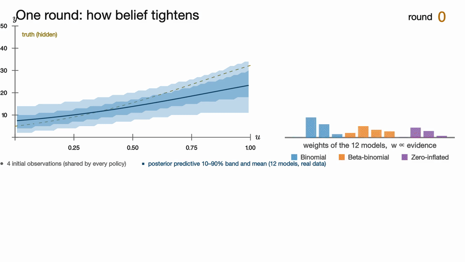

# Bayesian Model Discovery

Research code for discovering the functional form of an unknown system: a language model proposes
candidate model families, a Bayesian engine fits and compares them, and the next experiment is chosen by
expected information gain. Four benchmark adapters and a direct in-context learning baseline are included.

[](LICENSE)
[](REQUIREMENTS.md)
[](https://github.com/JooKyung-Yuh/bayesian-model-discovery/actions/workflows/ci.yml)



*One round of the loop (15 s). The full three-act explainer, `bmd_explainer_acts1-3.mp4` (90 s), is attached to the GitHub release.
The animation runs on a September 2026 pilot of the engine on a synthetic binomial world (true law Binomial(50, σ(−0.8 + 1.4(2u − 1))),
twelve fixed models = four mean structures × three observation families, four shared initial observations, twenty rounds, the joint-EIG grid
policy). It illustrates the mechanism only: the benchmark protocol differs (four benchmarks, five acquisition arms, thirty rounds,
LLM-proposed pools, masked names), and no number shown in the animation is an experimental result.*

Discovering an unknown system means finding a plausible **model family** (a functional form with an
observation distribution) and estimating its **parameters**, while choosing experiments that are worth
their cost. Bayesian Model Discovery (BMD) splits the two jobs. A language model **proposes** families
from a *belief packet* — the observations so far, the current expressions, their evidence, parameter
summaries and prediction errors. A numerical engine **fits** every candidate by sequential Monte Carlo
(SMC, in PyMC) from the same prior on the same data, scores it by its **model evidence** (marginal
likelihood), keeps the best-supported families in a **pool** of at most twelve, and **predicts** at
untested conditions with the evidence-weighted average of the pool (Bayesian model averaging, BMA). The
next experiment maximizes the **joint expected information gain** (EIG) — the information a response would
carry about *which family* generated it plus the information about *that family's parameters* — so the
loop keeps distinguishing families while it refines the one it favours. Each observation updates the
fits and weights and feeds the next proposals. The pool weights are conditional on the retained
alternatives: a weight near one means dominance over the pool, not certainty over every possible law.

The runners in this repository drive the loop on four simulated scientific benchmarks (ChemBench, BoxingGym,
ForceBench, NeuronBench) under one shared protocol, next to a direct in-context learning (ICL) forecaster that
receives the same observations, so that model-pool discovery with sequential design can be compared against
using the language model alone. The engine, the four runners and every prompt used are in this repository; the
run records of the experiments are not (see [Reproducing the benchmark runs](USAGE.md#reproducing-the-benchmark-runs)).

> Research code. Interfaces and file formats can change without a deprecation period.

## The loop

```text
         public data D = initial design + every observation so far
                                   |
  +--------------------------------v--------------------------------+
  | 1 propose   the LLM reads the belief packet and returns         |
  |             candidate expressions as JSON                       |
  | 2 validate  grammar, roles, duplicates, prior probe             |
  | 3 fit       one SMC fit per candidate, from the prior, on all D |
  | 4 admit     rank all models by log evidence, keep the top 12    |
  | 5 predict   evidence-weighted average over the pool (BMA)       |
  | 6 choose    the next design by the run's criterion: joint EIG   |
  |             (default), Model EIG, Parameter EIG, expected predictive information gain (EPIG) or random |
  +--------------------------------+--------------------------------+
                                   |
             observe the outcome at that design, add it to D,
             refit the pool, start the next round
```

[`FLOW.md`](FLOW.md) goes through each step and names the module that implements it.

## What is in the repository

- `src/bayes_model_discovery/experimental/`: the engine (expression grammar and model identity,
  SMC fitting for bounded counts, positive, real-valued and vector outcomes, belief packets and
  system prompts, LLM transports, design criteria) and the runners of four benchmarks:
  `core_count` (synthetic counts), `chembench_core`, `boxinggym_core` and `neuron_core`.
- `tools/fb1_snapshot/run_gravity.py`: the ForceBench runner, a standalone script with its own
  jax environment.
- `scripts/bmd_run.py`: runs one cell of any benchmark; `scripts/provision.sh`: sets up a clean
  Linux host.
- `examples/`: five notebooks, committed with their outputs.
- `tools/release/`: the release checks (`release_checks.sh`) and the syntax-tree comparison
  (`ast_equiv.py`) described in [`REPRODUCIBILITY.md`](REPRODUCIBILITY.md).

### Where the main ideas live

| Concept | In the code |
| --- | --- |
| belief packet (observations, expressions, evidence, parameter summaries, prediction errors, archive) | `experimental/belief_packet.py` |
| proposing families with the LLM; grammar, roles, duplicate and prior-probe checks | `experimental/count_proposer.py` (ChemBench, BoxingGym, synthetic counts), `experimental/neuron_proposer.py`, `tools/fb1_snapshot/fb1_proposer.py` + `fb1_grammar.py`; model identity in `experimental/model_identity.py`, expressions in `experimental/count_models.py` |
| fitting a family by SMC, its evidence and posterior predictive | `inference/smc.py` (backend), `experimental/count_inference.py` (counts), `positive_inference.py`, `real_inference.py`, `vector_inference.py` (NeuronBench), `tools/fb1_snapshot/fb1_core.py` (ForceBench) |
| the pool of at most K families, evidence weights, Bayesian model averaging | the runners: `experimental/core_count.py`, `boxinggym_core.py`, `chembench_core.py`, `neuron_core.py`, `tools/fb1_snapshot/run_gravity.py` |
| joint EIG = family information + parameter information; Model EIG, Parameter EIG, EPIG, random | `eig/joint.py` (the estimator and its decomposition), `experimental/design_policies.py`, `experimental/count_epig.py`; design search in `experimental/design_search.py`, `boxinggym_design_search.py`, `tools/fb1_snapshot/fb1_design_search.py` |
| the prompt texts the proposer sends (hash-bound) | `src/bayes_model_discovery/experimental/prompts/`, `tools/fb1_launch_c/*.txt`, `tools/fb1_snapshot/prompts/` |
| benchmark interfaces | `experimental/chembench_core.py` + `adapters/chembench_observation.py`, `boxinggym_core.py`, `neuron_core.py` + `neuron_forward.py`, `tools/fb1_snapshot/fb1_forward.py` + `world_constants.py` |

Module paths are relative to `src/bayes_model_discovery/` unless they start with `tools/`.

## Installation

You need Linux on x86-64, Python 3.12, git and a C/C++ compiler such as `g++` (PyTensor
compiles C code the first time it builds a model). From the repository root:

```bash
python3.12 -m venv .venv
source .venv/bin/activate
pip install -c requirements.lock -e ".[dev]"
```

On a clean host, `bash scripts/provision.sh` builds the same environment from the lock file
(installing Python 3.12 with `uv` if needed) and checks the pinned versions. With
`--with boxinggym,neuronbench,forcebench` it also fetches the external benchmark code at its
pinned commits, builds the separate ForceBench environment and writes `.bmd_env.sh` with the
environment variables the run scripts read; `--smoke` ends with a one-round mock run. It never
reads a `.env` file.
[`REQUIREMENTS.md`](REQUIREMENTS.md) lists everything the code needs.

## Quickstart (no API key, no cost)

Three rounds of the full loop on the synthetic count benchmark, with the built-in mock proposer
in place of the LLM:

```bash
python -m bayes_model_discovery.experimental.core_count \
  --profile dev --proposer mock --seed 11 --cell 111 --rounds 3 \
  --output runs/quickstart_synthcount
```

It takes a few minutes, most of them for PyTensor compilation and SMC. Each fit prints a `FIT`
line with its log evidence and each scoring step a `SCORE` line with the held-out NLL; the run
folder is described in [`FLOW.md`](FLOW.md#the-run-folder). The output folder must not exist
yet; no runner overwrites one.

`scripts/bmd_run.py` runs one cell of any benchmark through its own runner, with the mock
proposer by default:

```bash
python scripts/bmd_run.py synthcount --arm joint_eig --rounds 2 --profile dev --output runs/smoke
```

[`USAGE.md`](USAGE.md) lists its arms per benchmark, the dry run, the paid-run safeguards, the
tests and how to reproduce the benchmark runs.

## Benchmarks

| Benchmark | What is measured | External source, commit, license | Enabled in this release |
| --- | --- | --- | --- |
| SynthCount (`core_count`) | a dose–response law for counts out of 50 trials on one input in [0, 1]; the engine generates the worlds | none | yes |
| ChemBench (`chembench_core`) | a chemical rate law over seven named inputs | LLM-AutoSciLab, which states no license | **no** |
| BoxingGym (`boxinggym_core`) | ten simulated environments with count, binary, positive, real-valued or trajectory outcomes, scored by the environment's own evaluator and by the engine's predictive scores | fork https://github.com/JooKyung-Yuh/BoxingGym, `06c790aa8e23c1f8f1858f0955ec4ffc9e4c61ba`, MIT | yes |
| NeuronBench (`neuron_core`) | which ion-channel mechanism a simulated neuron has, from features of its voltage response to injected current (six worlds) | https://github.com/murphyk/neuronbench, `c354622458c460b419cab821d482c879f0578377`, MIT | yes |
| ForceBench (`tools/fb1_snapshot/run_gravity.py`) | a force law, from simulated trajectories (five worlds) | DiscoverPhysics, https://github.com/SampsonML/DiscoverPhysics, `33b7fa9df96de9c35744efd181ca7e5a8dd60ad5`, MIT | yes, in a separate jax environment |

ChemBench's true laws and input ranges come from LLM-AutoSciLab, whose repository states no
license. Its code stays in the tree, but the run script refuses it, the provisioning script does
not fetch the dependency, and its tests skip; it will be enabled once the license is clarified.

## Notebooks

The notebooks in [`examples/`](examples/) use the mock proposer: no API key, no network, no
cost. They are committed with their outputs and can be read without running anything.

| Notebook | What it shows | Needs |
| --- | --- | --- |
| [`00_how_it_works`](examples/00_how_it_works.ipynb) | the algorithm in full: evidence weights, the three EIG terms and EPIG with formulas, the protocol in detail, the five benchmarks, a long glossary | the base install; runs no model |
| [`01_engine_basics`](examples/01_engine_basics.ipynb) | the quickstart run, its run folder one round at a time, then the grammar check, the prior probe, one SMC fit, the evidence weights and one EIG step reproduced by calling the engine | the base install (about 4 minutes the first time) |
| [`02_what_the_llm_sees`](examples/02_what_the_llm_sees.ipynb) | one belief packet as it is sent, the system prompt and its sha256, the multi-candidate and archive review paragraphs | the run of notebook 01 |
| [`03_eig_decomposition`](examples/03_eig_decomposition.ipynb) | joint EIG = Model EIG + Parameter EIG on a hand-made table and on a saved posterior, EPIG on the same designs | the base install |
| [`04_reading_a_run_folder`](examples/04_reading_a_run_folder.ipynb) | `config.json`, `scores.jsonl` and `points.csv`, one score reproduced by hand, two runs compared | the run of notebook 01 |

## How the benchmark experiments were run

The benchmark runs used the engine in this tree with benchmark-specific settings (initial observations,
budget, SMC size, pool sizes, proposal schedule). The unified
protocol of the main campaign shares one design across benchmarks: an initial batch
of twelve proposals, a pool of at most twelve models, one LLM call with three candidates per
round, and an archive review every fifth round (NeuronBench starts from four fixed mechanisms,
keeps six and has no review). Runs lasted 30 rounds (ForceBench 16, NeuronBench 5) with seeds
31, 37 and 41 (one BoxingGym task used 47 in place of 37) and compared the five design criteria
(four on ChemBench). The exact trees the runs were launched from are tagged in the private development repository
(`paper-2026-10/<benchmark>-u3`, with the full development history), not in this one; every run records the
sha256 of the engine source files it loaded and of the prompt file it sent, so a run can be tied
to the code that produced it, and requests to reproduce a run go to the authors.

## Read more

- [`FLOW.md`](FLOW.md): one round step by step, the design criteria, the protocol of the benchmark runs
  runs, the run folder and a glossary.
- [`USAGE.md`](USAGE.md): running each benchmark, paid runs, tests, notebooks, prompt files and
  reproducing the benchmark runs.
- [`REQUIREMENTS.md`](REQUIREMENTS.md): Python environments, compiler, external checkouts and
  their environment variables, disk and time.

## Contributors

This repository was built by JooKyung Yuh together with AI coding agents working under the
author's direction: Claude Code (Anthropic) and Codex (OpenAI). The agents wrote most of the
code, tests and documentation commit by commit; the author set the goals, reviewed the work and
made the decisions. The private development history records this directly; every commit in this repository
carries the trailer `Co-Authored-By: Claude <noreply@anthropic.com>`.

## Citation

Cite the software through [`CITATION.cff`](CITATION.cff).

## License

MIT; see [`LICENSE`](LICENSE). Third-party code:

- **BoxingGym** (https://github.com/kanishkg/boxing-gym, MIT, copyright (c) 2024 Kanishk Gandhi,
  arXiv:2501.01540). The BoxingGym runner imports BoxingGym from a separate checkout of the fork;
  nothing from it is redistributed here.
- **DiscoverPhysics** (https://github.com/SampsonML/DiscoverPhysics, MIT). The ForceBench runner
  in `tools/fb1_snapshot/` derives from it: it calls the DiscoverPhysics simulator from a
  separate checkout and follows its integration method and settings.
- **neuronbench** (https://github.com/murphyk/neuronbench, MIT), imported from a separate
  checkout.

External repositories are not redistributed here and carry their own licenses (table above).

## Contact

johnlu0410@korea.ac.kr
